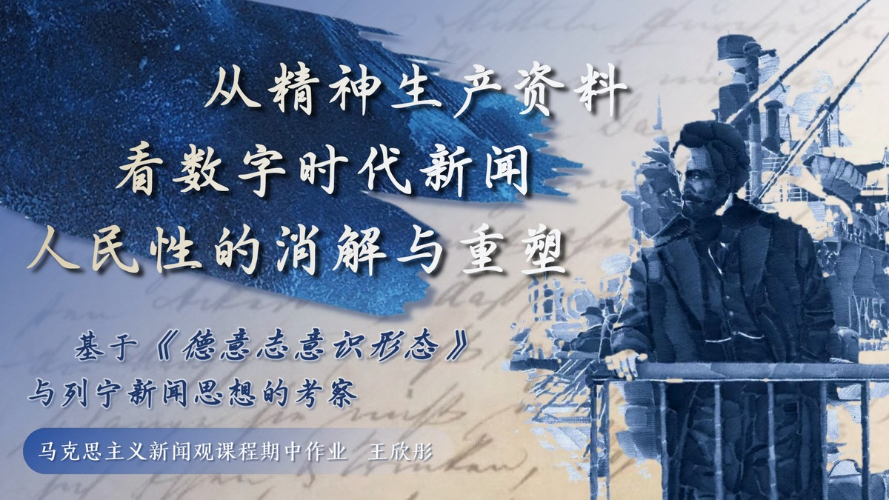
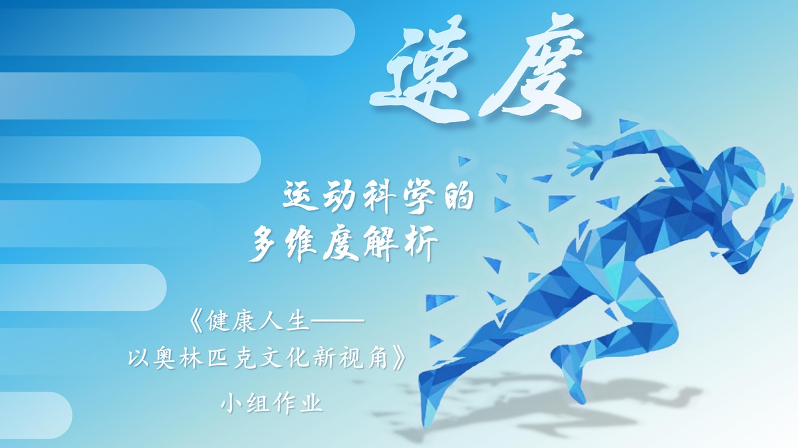
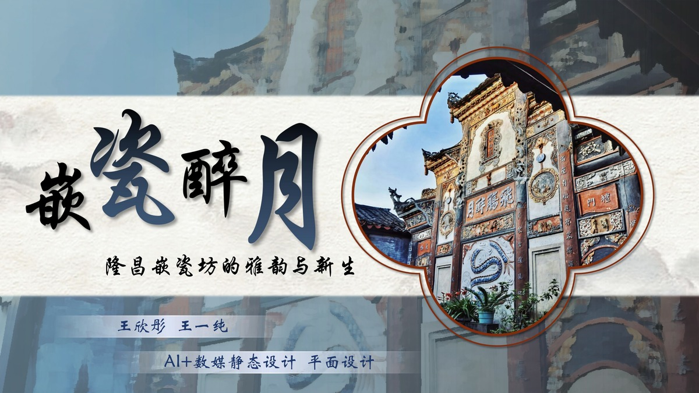

> 归档说明：本页用于梳理新媒体交互设计、AI 自动化工作流等课程实践材料。内容以可替换的图片位为主，便于后续按实际作业版本逐步更新。

## 长图版 PPT 归档

  <a class="ppt-card" href="/posts/post-1/assets/ppt-01.jpg" target="_blank" rel="noopener noreferrer">
    
    

      
从精神生产资料看数字时代新闻人民性的消解与重塑

      点击查看完整长图 →
    

  </a>

  <a class="ppt-card" href="/posts/post-1/assets/ppt-02.jpg" target="_blank" rel="noopener noreferrer">
    
    

      
速度——运动科学的多维度解析

      点击查看完整长图 →
    

  </a>

  <a class="ppt-card" href="/posts/post-1/assets/ppt-03.jpg" target="_blank" rel="noopener noreferrer">
    
    

      
嵌瓷醉月——隆昌嵌瓷坊的雅韵与新生

      点击查看完整长图 →
    

  </a>

